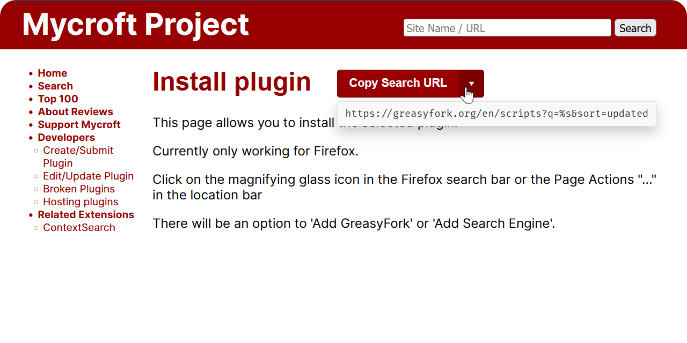

# Userscripts <!-- omit in toc -->

- [Claude](#claude)
  - [Allow paste as text](#allow-paste-as-text)
  - [Prevent keyboard hijacking](#prevent-keyboard-hijacking)
  - [Rename chats with date prefix](#rename-chats-with-date-prefix)
- [Etsy](#etsy)
  - [Open links in current tab](#open-links-in-current-tab)
- [GitHub](#github)
  - [Show all by default](#show-all-by-default)
- [Google Docs](#google-docs)
  - [Auto-hide Tabs sidebar](#auto-hide-tabs-sidebar)
- [Imgur](#imgur)
  - [Redirect to image file](#redirect-to-image-file)
- [Mycroft Project](#mycroft-project)
  - [Copy search URL's](#copy-search-urls)
- [Reddit](#reddit)
  - [Disable expando buttons for link posts](#disable-expando-buttons-for-link-posts)
  - [Prevent navigation except for post titles](#prevent-navigation-except-for-post-titles)
  - [Subreddit Wiki button](#subreddit-wiki-button)

## Claude

### Allow paste as text

Allows for pasting longer text snippets directly into the chat input by bypassing the 4096-byte threshold that converts pasted text into an attachment card.

### Prevent keyboard hijacking

Prevents Claude.ai from intercepting the Firefox keyboard shortcut <kbd>Ctrl</kbd>+<kbd>Shift</kbd>+<kbd>I</kbd> for opening the devtools.

### Rename chats with date prefix

Every 12 hours, prefixes the titles of new chats with their creation date ("MM/DD/YYYY: \[Original title\]")

## Etsy

### Open links in current tab

Force links on Etsy to open in the same tab by removing the target attribute.

## GitHub

### Show all by default

When navigating to any GitHub repository's Issues or Discussions pages, display all by default instead of filtering for `is:open`.

## Google Docs

### Auto-hide Tabs sidebar

Hide the Tabs sidebar in all Google Docs by default.

## Imgur

### Redirect to image file

Redirects Imgur post pages to the direct image file instead.

## Mycroft Project

### Copy search URL's

Adds a button to search engine install pages on Mycroft Project to easily copy the search URL to the clipboard.

## Reddit

### Disable expando buttons for link posts

For Reddit posts that are external links or title-only text posts, gray out the expando button and revert the not-allowed cursor to standard.

### Prevent navigation except for post titles

Prevent clicks within the main Reddit feed from navigating to posts unless the post title is clicked directly.

### Subreddit Wiki button

Adds a Wiki button to subreddit masthead between Join button and overflow menu
